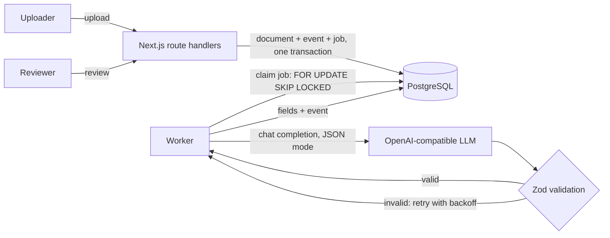
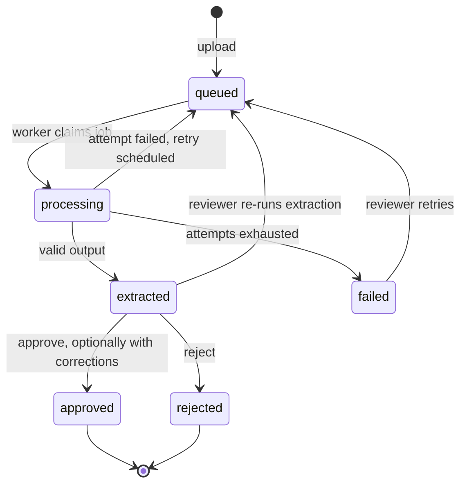

# DocExtract

Upload a document, extract structured fields with an LLM in the background, then have a reviewer verify, correct and approve the result before it is trusted.

DocExtract treats model output as untrusted input. Every response is validated against a schema, extraction runs on a retrying job queue, every state change is recorded in an audit log, and extraction quality is measured with an evaluation harness.

## Features

- **Background extraction** on a PostgreSQL-backed job queue with retries, exponential backoff, deduplication and crash recovery
- **Schema-validated LLM output** with any OpenAI-compatible provider (Groq, OpenRouter, LiteLLM, a local llama.cpp server)
- **Human review** with field-level corrections and atomic, race-free status transitions
- **Authentication and authorization** with server-side sessions, three roles and object-level access control
- **Audit log** of every state change, including who changed what and the reviewer's corrections
- **Evaluation harness** reporting per-field accuracy, missing values and hallucinations across a test dataset
- **Observability** through structured JSON logs, request ids, and LLM latency and token usage per extraction
- **Tested** with unit tests and with integration tests that run the API route handlers and the worker against a real PostgreSQL database in CI

## Architecture



The web application and the worker are separate processes that share only the database. Uploading a document inserts the document, its audit event and its extraction job in a single transaction, so a document can never exist without the job that processes it.

Each document moves through this lifecycle:



## Design decisions

Significant decisions are documented as [Architecture Decision Records](docs/adr/README.md):

- [0002](docs/adr/0002-drizzle-orm.md) Drizzle ORM for typed queries, SQL migrations and raw SQL where needed
- [0003](docs/adr/0003-postgresql-job-queue.md) A job queue in PostgreSQL for transactional enqueueing without extra infrastructure
- [0004](docs/adr/0004-session-authentication.md) Server-side sessions with scrypt hashing and hashed session tokens
- [0005](docs/adr/0005-untrusted-llm-output.md) Validation, human review and evaluation for LLM output

## Roles

| Role | Upload | View documents | Run extraction | Approve or reject |
| --- | --- | --- | --- | --- |
| `uploader` | Yes | Own documents only | No | No |
| `reviewer` | Yes | All | Yes | Yes |
| `admin` | Yes | All | Yes | Yes |

New accounts are uploaders. Promote a user with `npm run user:role -- user@example.com reviewer`. The `admin` role currently has the same permissions as `reviewer` and is reserved for future administrative features.

## API

Document endpoints and `/api/auth/me` require a session cookie. Errors are returned as `{"error": "...", "details": ...}` with an `x-request-id` header for correlation with the logs.

| Method | Path | Access | Description |
| --- | --- | --- | --- |
| `POST` | `/api/auth/signup` | Public | Create an uploader account (password of at least 12 characters) and start a session |
| `POST` | `/api/auth/login` | Public | Start a session |
| `POST` | `/api/auth/logout` | Public | End the current session, if any, and clear the cookie |
| `GET` | `/api/auth/me` | Authenticated | Current user |
| `POST` | `/api/documents` | Authenticated | Upload a text document (`multipart/form-data`, field `file`, max 1 MB) and queue extraction |
| `GET` | `/api/documents` | Authenticated | List up to 50 visible documents, newest first |
| `GET` | `/api/documents/:id` | Authenticated | Document with its extracted fields |
| `GET` | `/api/documents/:id/events` | Authenticated | Audit history of the document |
| `POST` | `/api/documents/:id/extract` | Reviewer | Queue a new extraction attempt (`202 Accepted`) |
| `PATCH` | `/api/documents/:id` | Reviewer | `{"action":"approve","fields":{...}}` or `{"action":"reject"}` |

## Running locally

Requirements: Node.js 22 or later, PostgreSQL 15 or later, and an API key for any OpenAI-compatible provider.

```bash
git clone https://github.com/daen8584-spec/docextract.git
cd docextract
npm install
cp .env.example .env
```

Edit `.env`: set `DATABASE_URL` to your PostgreSQL connection string and `LLM_BASE_URL`, `LLM_API_KEY` and `LLM_MODEL` to your provider. Then create the database and apply the migrations:

```bash
createdb docextract
npm run db:migrate
```

Start the web application and the worker in separate terminals:

```bash
npm run dev
npm run worker
```

Open http://localhost:3000, create an account, promote it with `npm run user:role -- <email> reviewer`, and upload `eval/cases/01-simple.txt`.

## Testing

```bash
npm run test:unit
createdb docextract_test
npm run test:integration
```

The integration tests use `TEST_DATABASE_URL`, which defaults to `DATABASE_URL` with the database name changed to `docextract_test`. They refuse to run against the same database as `DATABASE_URL`, because they truncate every table.

Unit tests cover the extraction client, scoring and field diffing with no external dependencies. Integration tests call the route handlers and the worker against a real PostgreSQL database and cover authentication, authorization, the audit log, concurrent reviews, queue semantics (deduplication, concurrent claims, backoff, crash recovery) and the extraction retry flow. The LLM is mocked in all tests. CI runs lint, type checking, both test suites and a production build on every push.

## Evaluating extraction quality

```bash
npm run eval
npm run eval -- --min-accuracy 0.95
```

The harness runs every case in `eval/cases` through the extraction pipeline and reports exact-match rate and per-field accuracy, separating incorrect values, missing values and hallucinated values. The dataset covers line items with tax, European and Chilean number formats, written-out dates, currency symbols, receipts without invoice numbers and documents with distracting reference numbers. With `--min-accuracy` the command exits non-zero when field accuracy falls below the threshold, so it can gate prompt or model changes. Full results for each run are written to `eval/results/`, which is not committed.

Reviewed documents can be turned into new cases:

```bash
npm run eval:export
```

This exports approved documents whose fields the reviewer corrected, using the approved values as ground truth. Add `-- --all` to export every approved document. Exported files contain real document content and should be reviewed before they are committed.

## Observability

Logs are structured JSON on stdout. Every API request logs its method, path, status and duration under a request id, which is also returned in the `x-request-id` response header. Worker logs carry the job id and attempt number. Each successful extraction records the model, latency and token usage in the audit log.

## Project structure

```
app/            Next.js pages and API route handlers
components/     React components
db/             Schema and SQL migrations
docs/adr/       Architecture Decision Records
eval/cases/     Evaluation dataset
lib/            Domain logic: auth, documents, extraction, queue, worker, evaluation
scripts/        Command-line tools (roles, evaluation)
tests/          Integration tests
worker/         Background worker entry point
```

## Roadmap

- PDF support with text extraction
- Rate limiting on login and upload
- Confidence scores and highlighting of uncertain fields
- `LISTEN/NOTIFY` to start jobs without polling delay
