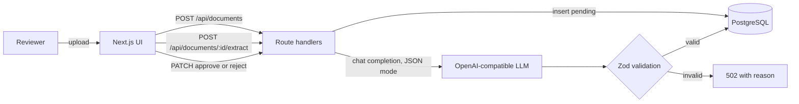
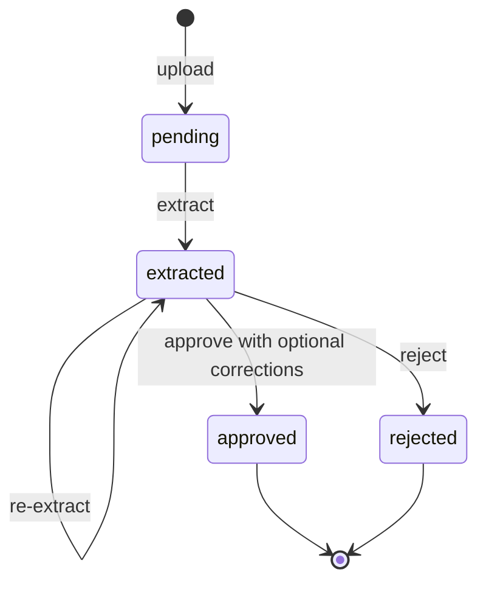

# DocExtract

Upload a document, extract structured fields with an LLM, then have a person review, correct and approve the result before it is trusted.

## Why

LLMs are good at reading unstructured documents but they are not always right. DocExtract treats model output as a draft: every response is validated against a schema, and nothing is final until a reviewer approves it.

## Architecture



Each document moves through a strict lifecycle:



## Design decisions

- **Model output is untrusted input.** Responses are parsed and validated with Zod before they reach the database. Malformed JSON, wrong types or invalid dates return a `502` with the exact reason instead of storing bad data.
- **Atomic status transitions.** Reviews update with `WHERE status = 'extracted'`, so two reviewers acting at the same time cannot overwrite each other. The second one gets a `409`.
- **Provider-agnostic LLM client.** Any OpenAI-compatible endpoint works (Groq, OpenRouter, LiteLLM, a local llama.cpp server) by changing three environment variables. No SDK lock-in.
- **Human in the loop.** Reviewers can correct any field before approving. Approved and rejected documents are immutable.
- **Server components with streaming.** Pages render a static shell and stream database content through Suspense (Next.js Cache Components and Partial Prerendering).

## Tech stack

TypeScript, Next.js 16 (App Router), React, Tailwind CSS, PostgreSQL, Drizzle ORM, Zod, Vitest, GitHub Actions.

## API

| Method | Path | Description |
| --- | --- | --- |
| `POST` | `/api/documents` | Upload a text document (`multipart/form-data`, field `file`, max 1 MB) |
| `GET` | `/api/documents` | List the 50 most recent documents |
| `GET` | `/api/documents/:id` | Get a document with its extracted fields |
| `POST` | `/api/documents/:id/extract` | Run LLM extraction on a pending or extracted document |
| `PATCH` | `/api/documents/:id` | Review with `{"action":"approve","fields":{...}}` or `{"action":"reject"}` |

## Running locally

Requirements: Node.js 22+, PostgreSQL 15+, and an API key for any OpenAI-compatible provider.

```bash
git clone https://github.com/daen8584-spec/docextract.git
cd docextract
npm install
cp .env.example .env
createdb docextract
npm run db:migrate
npm run dev
```

Set `DATABASE_URL` and the `LLM_*` variables in `.env`, then open http://localhost:3000 and upload `fixtures/sample-invoice.txt`.

## Testing

```bash
npm test
```

Unit tests cover the extraction client: successful parsing, missing fields, schema violations, non-JSON output, upstream HTTP errors, network failures and missing configuration. The LLM is mocked, so tests need no network or API key. CI runs lint, type checking, tests and a production build on every push.

## Roadmap

- PDF support with text extraction
- Confidence scores and highlighting of uncertain fields
- Audit log of reviewer corrections, usable as an evaluation set for prompt changes
- Authentication and per-user review queues
